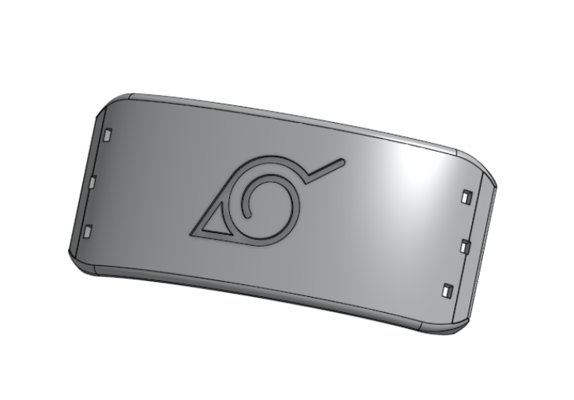
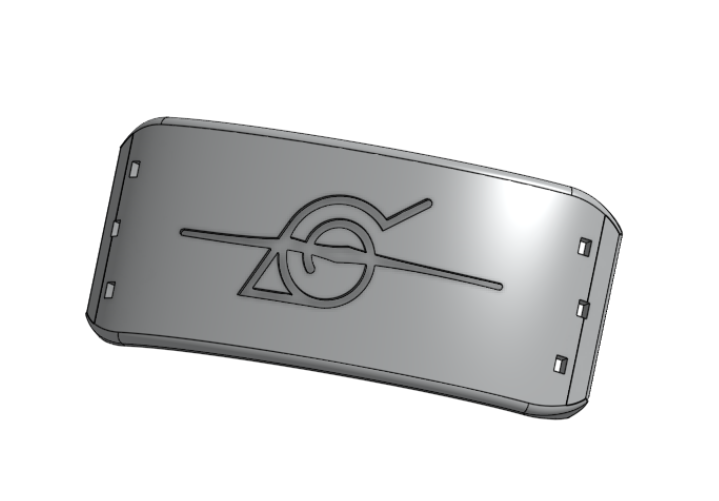
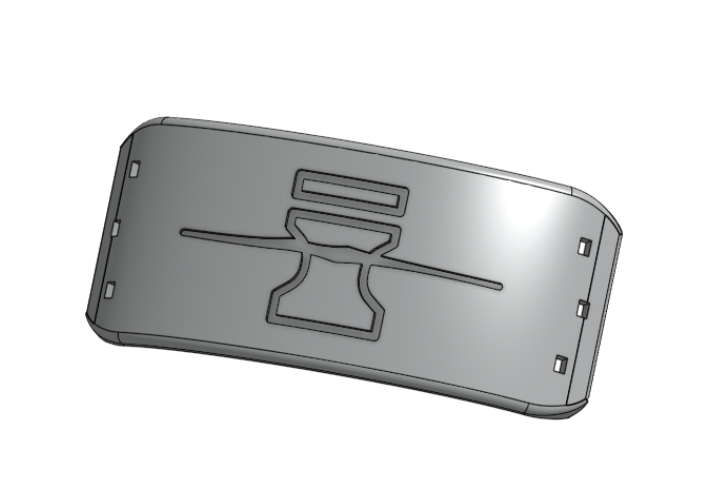
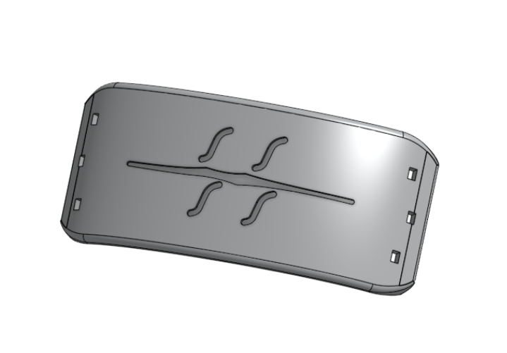
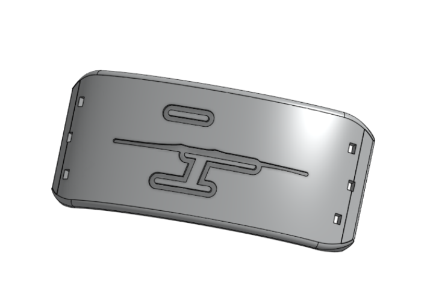
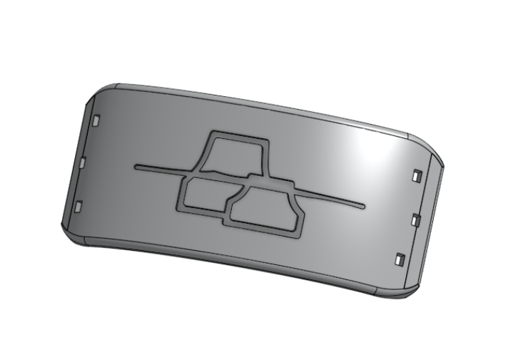

# NarutoHeadbands
One of my favorite anime, especially when I was growing up, was Naruto, so I decided to design CAD models of the forehead protectors they use. This features all 5 great shinobi villages & a rogue alternate for each, with a slash.

## Assembly:
6x 1-Inch 10mm Brass Fasteners. 

To attach these to a fabric of your choice, use 1-inch (10 mm) brass fasteners. Insert in each hole, poke through your fabric, and spread the prongs. 
(Note: as currently this is untested, this is only my intended purpose and may need to be altered.) 

# Extra
This was designed in Onshape and meant to be 3-D printed! However, I do not own a 3-D printer at the time, so the models will have to be sliced by you, the reader. Hopefully, they work out alright. Hope you enjoy the models, dattebayo! 

# Images 
### Leaf Village: 
 
### Sand Village: 
 
### Mist Village:
 
### Cloud Village:
 
### Stone Village: 
 
